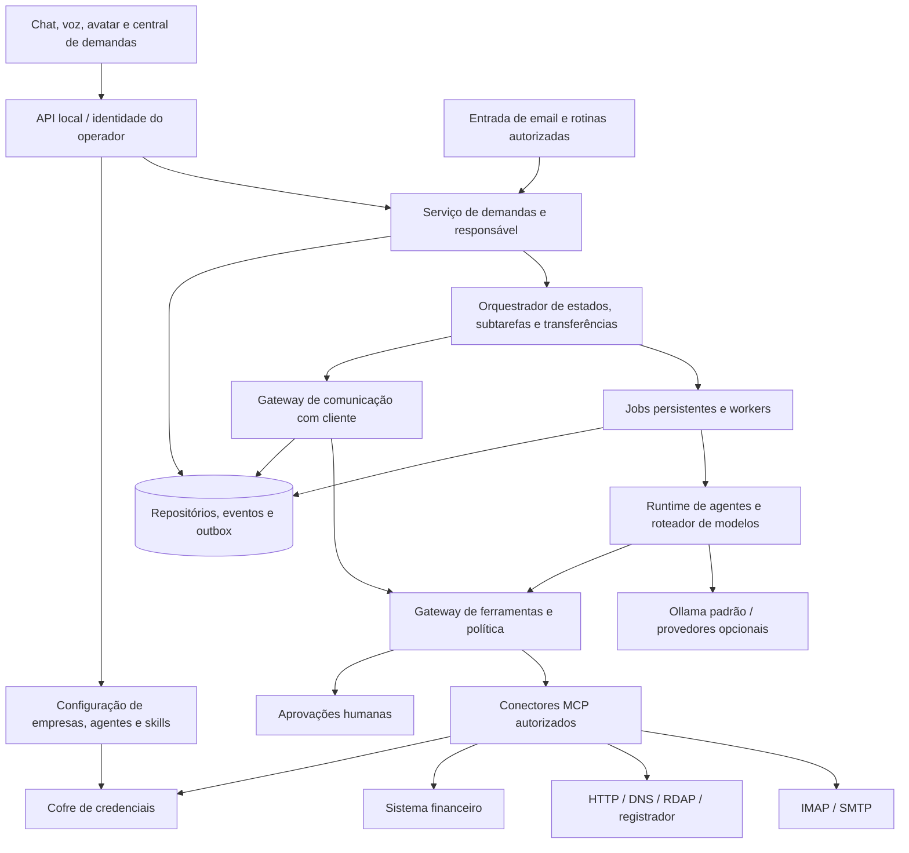
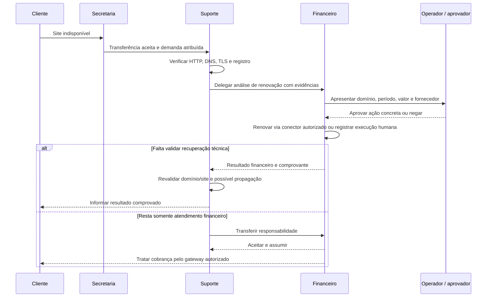

# Arquitetura da equipe de agentes

Status: proposta de implementação aprovada para planejamento na issue [#14](https://github.com/rafaelmaiabr/assistente/issues/14). O produto atual ainda tem um assistente por sessão, email fictício via MCP e perfis de voz. Equipes, demandas persistentes e integrações reais descritas aqui são futuras. O backlog e a ordem de execução estão em [TEAM-BACKLOG.md](TEAM-BACKLOG.md); o procedimento para Codex/Claude está em [TEAM-IMPLEMENTATION.md](TEAM-IMPLEMENTATION.md).

## Objetivo e unidades do produto

O operador configura empresas, departamentos, agentes, capacidades e contas. A equipe recebe uma demanda, identifica o responsável, executa trabalho autorizado, pede ajuda e mantém o cliente informado. Não é necessário um modelo nem um processo permanente para cada agente: uma definição de agente é uma configuração; uma execução instancia essa definição com contexto limitado e ferramentas concedidas.

| Conceito | Responsabilidade |
|---|---|
| Empresa / workspace | Fronteira de dados, contas, contatos, políticas e orçamento |
| Departamento | Escopo operacional e de conhecimento dentro da empresa |
| AgentDefinition | Papel, personalidade, objetivos, escopo, skills, política de modelo e voz, com versão |
| AgentRun | Execução temporária de uma definição, com orçamento, trace e contexto autorizado |
| SkillDefinition | Pacote declarativo reutilizável de instruções, contratos e ferramentas requeridas |
| SkillGrant | Concessão explícita de uma versão da skill para agente, conta, recurso e operação |
| Connection | Configuração de provedor e referência de credencial, sem o segredo |
| Case / demanda | Atendimento persistente com cliente, objetivo, evidências e um responsável atual |
| Task / subtask | Unidade de trabalho com resultado esperado, estado e eventual retorno |
| Handoff | Proposta e aceite de transferência de responsabilidade |
| ApprovalRequest | Autorização específica de ação concreta, com validade e uso único |
| Evidence / artifact | Fato/documento/resultado com fonte, data, revisão e escopo |

Um agente pode ter várias skills, e uma skill pode ser usada por muitos agentes. A mesma skill não compartilha automaticamente credenciais ou memória entre empresas. Instruções de uma skill não são concessão de permissão. Skills do produto são distintas das instruções de desenvolvimento AGENTS.md/SKILL.md usadas por Codex ou Claude.

## Componentes e fronteiras



Começar com um **backend Python modular**, mantendo LiveKit na adaptação de conversa, Ollama para geração local, React e Electron. Serviços de negócio não dependem do WebSocket nem do ciclo de vida de AgentSession. Não introduzir outro framework de agentes como pré-requisito: um ADR futuro deve demonstrar benefício antes de substituir a base.

Inicialmente, SQLite sob DATA_ROOT guarda entidades, eventos e jobs duráveis. As interfaces de repositório permitem PostgreSQL depois. O worker pode começar como componente do backend, com lease e checkpoint persistentes; não depende da aba. Em implantação de servidor, ele passa a processo separado. Fechar a janela pode interromper o processo local conforme configuração, mas a demanda persiste e pode ser retomada. Não prometer execução com computador desligado.

MCP é a fronteira preferencial de ferramentas. As regras de ownership, aprovação e idempotência pertencem aos serviços de domínio, não ao prompt nem ao protocolo. Comunicação interna usa contratos tipados e eventos persistentes. A2A é uma adaptação futura para agentes externos; não é necessário para os primeiros agentes dentro do mesmo backend.

## Configuração e contexto

Exemplo ilustrativo; o schema executável (T01, entregue) está descrito em [TEAM-CONTRACTS.md](TEAM-CONTRACTS.md) e nomes e campos finais prevalecem sobre este exemplo:

```yaml
tenant: empresa-x
department: financeiro
agent:
  id: financeiro
  version: 1
  personality:
    tone: profissional e objetivo
    initiative: propor próximos passos e pedir informação que falta
  scope: cobranças, recebimentos e análise financeira da Empresa X
  out_of_scope: encaminhar ao responsável ou pedir esclarecimento
  skills:
    - skill_ref: financeiro.consultar-pendencias@1.0.0
      connection_ref: erp-empresa-x
      operations: [read]
  model_policy_ref: local-primeiro
  voice_profile_ref: pf_dora
  handoff_targets: [secretaria, suporte]
```

Referências legíveis do exemplo não substituem IDs internos opacos. Valores de host, conta e tokens não vêm da LLM. Um contexto de execução confiável inclui principal, tenant_id, department_id, case_id/task_id quando houver, agent_run_id, versões de agente/skill/política, deadline e orçamento. O backend autentica/deriva essas relações e as valida; não aceita troca de empresa por argumento de ferramenta ou instrução de email.

Montagem do contexto: regras do produto → política e escopo → definição do agente → instruções da skill → objetivo e fatos autorizados da demanda → entrada do usuário/cliente e resultados externos explicitamente identificados como dados. Não concatenar email ou documentos no system prompt. A ordem orienta a LLM; a política no gateway decide o que é permitido. Recusa por assunto fora do escopo é comportamento avaliado, não garantia de segurança por prompt.

Personalidade não deve fabricar confirmação, intimidade com o cliente ou conhecimento sem fonte. Pode variar objetividade, tom e iniciativa; não pode remover aprovações. Catálogo de skills começa declarativo e local, com revisão de permissões, versão fixa e hash. Um manifesto importado não roda código. Instalar pacotes executáveis de terceiros exige uma evolução e revisão próprias.

## Demanda, subtarefa e responsável

Cada demanda tem um responsável atual. Na entrada pode existir somente a fila de triagem; após atribuição, há um único dono. Outros agentes podem trabalhar em subtarefas internas, sem ganhar o direito de responder externamente.

Estados propostos de demanda: recebida, triagem, em_execucao, aguardando_cliente, aguardando_aprovacao, aguardando_subtarefa, pausada, resolvida, falhou e cancelada. T01/T09 definem o grafo permitido. Estado, revisão e eventos são atualizados na mesma transação. Retomar demanda encerrada é uma transição explícita ou uma nova demanda vinculada, não uma alteração silenciosa do histórico.

**Delegação:** Suporte continua dono; Financeiro recebe uma subtarefa com motivo, objetivo, evidências mínimas, prazo e resultado esperado. O resultado financeiro volta ao Suporte, que verifica o site e responde ao cliente.

**Transferência:** o dono propõe passagem; Financeiro aceita; a troca ocorre atomicamente com revisão esperada. Até o aceite, Suporte segue responsável. Após o aceite, Financeiro pode atender o cliente; rascunhos e envios pendentes de Suporte precisam ser revalidados ou bloqueados. Agente indisponível, recusa ou timeout não cria um atendimento sem responsável: mantém o dono ou escala à fila humana.

O envelope de handoff contém case/task, origem, destino, tipo, motivo, contexto resumido com fontes, prazo, retorno opcional, revisão e identificador idempotente. Não contém segredos ou histórico inteiro por padrão. Acessos do destinatário são avaliados novamente; delegação não amplia permissões. Limites de saltos, profundidade, tentativas e orçamento impedem ciclos de agente para agente.

## Cenário de domínio e cobrança



O diagrama representa o caminho de sucesso; negação, preço alterado, expiração de aprovação, falha ou resultado desconhecido mantêm pendência e geram intervenção. “Site fora” não prova domínio vencido: falha de DNS, certificado, servidor, registro e propagação são evidências diferentes. RDAP pode estar indisponível ou não trazer data suficiente; o agente deve declarar incerteza e pedir confirmação ao registrador quando necessário.

Renovar um domínio, pagar o fornecedor e cobrar o cliente são ações distintas. O Financeiro não deduz que houve pagamento porque um email diz isso. Não há pagamento bancário autônomo no escopo inicial: confirmação humana e reconciliação são suportadas. Integrações reais de registrador e ERP ficam bloqueadas até escolher fornecedores e conhecer suas APIs. O fluxo manual rastreado permite validar a equipe antes disso.

Quando a demanda for apenas financeira, a Secretaria pode transferir diretamente ao Financeiro, sem envolver Suporte. O cliente não precisa conhecer toda a organização: mensagens externas saem pelo gateway com identificação coerente e um dono. Notas internas não são enviadas como resposta.

## Durabilidade, concorrência e efeitos externos

Comandos/eventos incluem id, schema_version, tenant_id, case_id/task_id, correlation_id, causation_id, actor_id, revisão esperada e timestamp. Eventos representam fatos comprometidos no banco. Uma outbox transacional conecta mudança de estado a trabalho e notificações pendentes. Não exigir event sourcing integral: tabelas de estado com eventos auditáveis são suficientes inicialmente.

Jobs usam claim atômico, lease, heartbeat, deadline, retry limitado e chave idempotente. Orçamento cobre passos, chamadas, tokens conhecidos e duração; a primeira configuração serializa gerações no Ollama para não competir com a GPU de 6 GB. Agentes inativos são definições baratas, não modelos residentes. Filas posteriores aplicam quotas e justiça por empresa, conta e modelo.

A entrega de eventos pode ocorrer mais de uma vez. Consumidores deduplicam. Não prometer exactly-once para email, compra ou APIs externas: o servidor pode executar a ação e perder a resposta. Nessa situação, persistir estado desconhecido, consultar o provedor/reconciliar ou pedir intervenção. Não repetir cegamente renovação, emissão ou envio. Resultado só é “executado” com confirmação técnica verificável; leitura e entrega de email são estados diferentes.

Transferência e saída externa precisam de serialização por demanda. Uma checagem isolada antes do envio não resolve a corrida com handoff: worker/gateway deve estabelecer a ordem da operação e conferir ownership/revisão no compromisso de envio. Se envio já estiver em trânsito, handoff registra esse fato; não cria certeza falsa de cancelamento.

## Aprovações, acesso e credenciais

Política default-deny: listar somente ferramentas concedidas e conferir toda chamada no gateway. Inicialmente, antes de T13, chamadas com efeito externo permanecem bloqueadas. Depois, renovar, emitir cobrança, alterar recurso e responder externamente exigem uma aprovação ou política explicitamente configurada para aquela classe de ação. Regras de autonomia futura precisam de limites, responsável, revogação e auditoria; não são inferidas de autorização para fazer merge de código.

Aprovação vincula ação normalizada/hash, conta, recurso, destinatários, valor/moeda quando houver, prazo, aprovador e uso único. Alterar preço, período, destinatário ou payload invalida a aprovação. Instrução do cliente, resposta de modelo, resultado MCP ou email não pode aprovar ação. O operador pode assumir e pausar; desconexão não equivale a consentimento.

Credenciais pertencem à conexão da empresa e ficam no cofre do Windows no modo local. Adaptador de segredos separado permite cofre de servidor depois. A LLM recebe referência/estado, nunca senha/token. O conector resolve somente o segredo necessário após autorização. Revogar conexão ou grant impede novas chamadas. Erros e telemetria não trazem payloads privados por padrão.

Modo local continua em loopback com origem exata, limites de mensagem e IPC Electron restrito. Isolamento entre empresas é lógico sob um único operador confiável; não protege contra processo comprometido executando na mesma conta Windows. Não expor esse modo na rede. Acesso remoto depende de T32: autenticação, RBAC, sessões, TLS, checagens por empresa em cada API/stream/arquivo e identidades de worker. Filtro de UI, system prompt e readOnlyHint não substituem essas checagens.

Em conectores de diagnóstico, bloquear SSRF, redirects internos e resolução para redes não autorizadas. Em emails/documentos, não carregar imagens externas, executar anexos ou interpretar instruções como política. Identidade do remetente e thread de email são evidências, não comprovação absoluta de autorização financeira.

## Histórico, conhecimento e observabilidade

O chat efêmero existente permanece disponível. Atendimento persistente exige opção clara de ativação; não importar histórico anterior silenciosamente. Dados ficam sob DATA_ROOT e fora do Git, pacote portable e Graphify: banco, backups, anexos, tokens, transcrições, logs e modelos.

Separar histórico do atendimento, preferências confirmadas e conhecimento publicado por departamento/empresa. Começar com busca local/FTS, sem exigir vector database. Autorizar documentos antes de recuperar trechos; fatos têm fonte, data e validade. Um resumo gerado pode ajudar o próximo agente, mas não substituir recibos ou evidências de ferramenta. Excluir/revogar conteúdo deve retirá-lo também dos índices e contextos futuros.

Auditoria guarda ator, decisão, referência de recurso, versões, eventos, uso conhecido, latência e resultado. Não guardar chain-of-thought. Dados sensíveis e segredos são redigidos; conteúdo bruto desativado por padrão. Retenção, exclusão, exportação, permissões de arquivos e backup/restauração precisam ser implementados e verificados antes de implantação remota. Backup não é protegido apenas por estar fora do Git; sua proteção e o cofre têm ciclos separados.

UI exibe empresa ativa, demanda, dono, aguardando humano, subtarefas e eventos. Reconecta por cursor com snapshot autoritativo e deduplica. Texto/áudio ficam vinculados à demanda e execução originais; troca de agente não liga microfone e não deve tocar uma resposta antiga em outra conversa. Fechar chat, interromper fala, cancelar geração e pausar demanda são operações distintas.

## Evolução por portas de saída

1. **Fundação local:** contratos, banco, política, agentes, skills e gateway; exemplos fictícios e LLM fake. Sem ação externa de escrita.
2. **Equipe demonstrável:** demandas, fila, delegação, transferência, Secretaria, aprovações e central de atendimento; teste sem conta externa.
3. **Trabalho real controlado:** IMAP somente leitura, entrada por email, SMTP aprovado, diagnóstico e Financeiro; autenticação por provedor como extensão.
4. **Cenário do domínio:** execução manual rastreada e testes completos. Automação de registrador/ERP é uma integração separada dependente de informação do operador.
5. **Operação contínua:** agendamentos, retenção, backup, métricas e conversa/voz com equipe.
6. **Escala/interop:** identidade remota antes de expor serviços; evals; PostgreSQL/workers separados quando houver necessidade; A2A para contrapartes autorizadas.

Cada issue é uma entrega verificável. Fases são agrupamento, não autorização para implementar várias juntas; o grafo de dependências do backlog decide elegibilidade. Fornecedores não escolhidos não bloqueiam o fluxo local com fixtures e execução manual.

## Relação com o código atual

| Ponto atual confirmado | Evolução planejada |
|---|---|
| `assistant_core.make_agent` monta prompt, LLM e todos os MCPs da sessão | Factory por definição/versionamento, tool gateway e política de modelo |
| `browser_agent.BrowserAgent` possui AgentSession por WebSocket | Adaptador de interação que acompanha execuções/demandas sem ser o armazenamento |
| `web_server.py` guarda estado efêmero da aba | API de chat continua; novos serviços persistentes e streams com escopo |
| `demo_mcp.py` retorna dois emails fictícios | Manter demonstração isolada; conectores IMAP e diagnóstico reais com concessões |
| `voice_profiles.py` e `voice_engine.py` configuram TTS | Referências de perfil por agente e cofre generalizado, preservando configurações |
| `settings.DATA_ROOT` separa dados do portable | Banco, configuração, anexos e índices no mesmo limite, excluídos de build/Graphify |
| `desktop/runtime.cjs` inicia backend e controla filhos próprios | Preservar ownership de processos; migrações e retomada sem matar serviços emprestados |

Os módulos novos citados nas issues são áreas sugeridas, não arquivos já existentes. Consultar o Graphify pelo wrapper e confirmar no código ao iniciar cada entrega; o grafo atual cobre a implementação presente, não este plano.

## Referências e decisões de protocolo

[MCP Tools](https://modelcontextprotocol.io/specification/2026-07-28/server/tools) define ferramentas com schemas; a segurança do produto continua sob responsabilidade do host. [MCP Security Best Practices](https://modelcontextprotocol.io/docs/2026-07-28/tutorials/security/security_best_practices) orienta limites de confiança e credenciais. [A2A Life of a Task](https://a2a-protocol.org/latest/topics/life-of-a-task/) descreve tarefas persistentes, contextos e estados entre sistemas.

Referências consultadas para planejamento em 2026-10-22; não pressupor que o SDK LiveKit/MCP instalado já suporta toda a revisão atual da especificação. Cada adapter deve declarar e testar sua versão compatível. O domínio interno não será acoplado ao enum de um protocolo externo. As decisões iniciais são monólito modular, SQLite/outbox, configuração declarativa, política fora do prompt, ownership único, local gratuito e MCP prioritário. Trocar banco/framework/protocolo exige ADR vinculado à issue correspondente, sem migração oportunista durante outra entrega.
